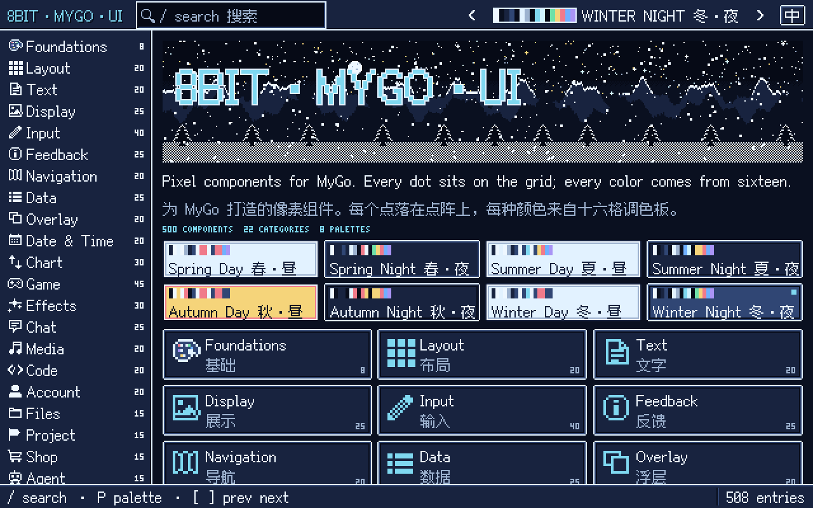

# 8bitMyGoUI



Pixel-art components in the manner of 16-bit consoles, for [MyGo](https://github.com/egoist/mygo) native UI. There are 500 of them in 22 categories, from a button to a chessboard. Every dot sits on the grid, every color comes from a sixteen-slot palette, and nothing is anti-aliased. Errors read GAME OVER and offer CONTINUE.

16 位游戏机风格的像素组件库，基于 MyGo 原生 UI：22 个分类，500 个组件。每个点落在点阵上，颜色只来自 16 格调色板，没有抗锯齿。换一套调色板，同一画面就有昼夜四季。

**Showcase:** <https://8bitmygoui.zhangyanghaha0407.workers.dev>. It is the same Go gallery, compiled to WebAssembly and drawn dot by dot in the browser.

## Install

```sh
go get github.com/ELY-Open-Source/8bitMyGoUI@latest
```

It needs Go 1.27.1 or later and builds on MyGo v0.6.2. MyGo's native UI needs nothing else; on Linux it runs on GTK 3.

## A first window

```go
package main

import (
	"fmt"
	"log"

	"github.com/egoist/mygo"
	"github.com/egoist/mygo/ui"

	"github.com/ELY-Open-Source/8bitMyGoUI/input"
	"github.com/ELY-Open-Source/8bitMyGoUI/pixel"
	"github.com/ELY-Open-Source/8bitMyGoUI/text"
)

// arcade is the app's state.
type arcade struct{ coins int }

func (a *arcade) view(c *ui.Context) {
	// Settings first: palette, dot size, locale.
	pixel.Use(c, pixel.Settings{Palette: pixel.WinterNight})
	k := pixel.K(c)
	ui.Column(c).Fill().Center().Gap(k.D(8)).Children(func() {
		text.ShadowText(c, fmt.Sprintf("%d COINS", a.coins), text.ShadowTextOptions{Scale: 2})
		if input.Button(c, "INSERT COIN", input.ButtonOptions{Variant: input.Primary}).Clicked {
			a.coins++
		}
	})
}

func main() {
	a := &arcade{}
	mygo.App.WhenReady(func() {
		mygo.NewWindow(mygo.WindowOptions{Title: "Arcade", Width: 480, Height: 320, Content: ui.View(a.view)})
	})
	if err := mygo.App.Run(); err != nil {
		log.Fatal(err)
	}
}
```

`pixel.Use` comes first in a view. Components ask for palette slots, never colors, and measure in dots.

## Palettes

Eight palettes: four seasons, by day and by night. Each has sixteen slots, such as Back, Face, Ink and Accent. Components draw with slots alone, so a new `Settings.Palette` repaints everything, dithering included.

| Value | Name | 名称 |
| --- | --- | --- |
| `pixel.SpringDay` | Spring Day | 春·昼 |
| `pixel.SpringNight` | Spring Night | 春·夜 |
| `pixel.SummerDay` | Summer Day | 夏·昼 |
| `pixel.SummerNight` | Summer Night | 夏·夜 |
| `pixel.AutumnDay` | Autumn Day | 秋·昼 |
| `pixel.AutumnNight` | Autumn Night | 秋·夜 |
| `pixel.WinterDay` | Winter Day | 冬·昼 |
| `pixel.WinterNight` | Winter Night | 冬·夜 |

## Dot

A dot is the grid's unit. `Settings.Dot` sets device-independent pixels per dot, from 1 to 4; zero means 2. Sizes in options are dots, and layout goes through `k.D(n)`. At the default, a 1280×800 window is 640×400 dots.

`Settings.Locale` picks the built-in copy, `pixel.En` or `pixel.Zh`. Motion steps at 4–15 frames a second. Under Reduce Motion, from the system or `Settings.Reduce`, decoration stands still or jumps to its end; loaders and countdowns keep time.

## Gallery

```sh
go run ./cmd/gallery    # the gallery in a native window
go test ./...           # engine, behavior, gallery invariants, architecture rules

cd web
npm install && npx playwright install chromium   # once
npm test                # build the showcase, then Playwright on a local server
./deploy.sh             # Cloudflare: upload, test the preview, promote, test live
```

In the gallery, `/` searches by English name, Chinese name or number, `P` changes the palette, and `[` and `]` step through the components.

## Components

| Category | 分类 | Components |
| --- | --- | --- |
| Layout | 布局 | 20 |
| Text | 文字 | 20 |
| Display | 展示 | 25 |
| Input | 输入 | 40 |
| Feedback | 反馈 | 25 |
| Navigation | 导航 | 20 |
| Data | 数据 | 25 |
| Overlay | 浮层 | 20 |
| Date & Time | 日期时间 | 20 |
| Chart | 图表 | 30 |
| Game | 游戏 | 45 |
| Effects | 特效 | 30 |
| Chat | 聊天 | 25 |
| Media | 媒体 | 20 |
| Code | 代码 | 20 |
| Account | 账户 | 20 |
| Files | 文件 | 15 |
| Project | 项目 | 15 |
| Shop | 商店 | 15 |
| Agent | 智能体 | 15 |
| Desk | 桌面 | 20 |
| Tabletop | 桌游 | 15 |
| **All** | **全部** | **500** |

Eight foundation pages show the engine: palettes, canvas, dither, the pixel font, icons, sprites, the editor and focus.

## Licenses

MIT, in `LICENSE`. The programs include MyGo (MIT), Ark Pixel Font (SIL OFL 1.1), rsc.io/qr (BSD-3-Clause) and a few more; see [THIRD_PARTY_NOTICES.md](THIRD_PARTY_NOTICES.md).
